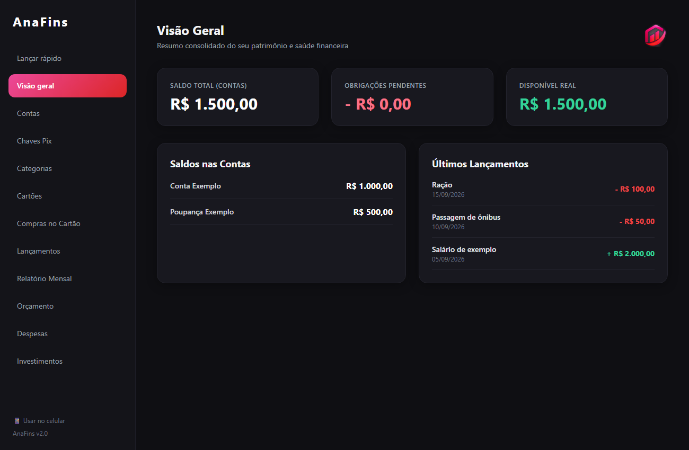
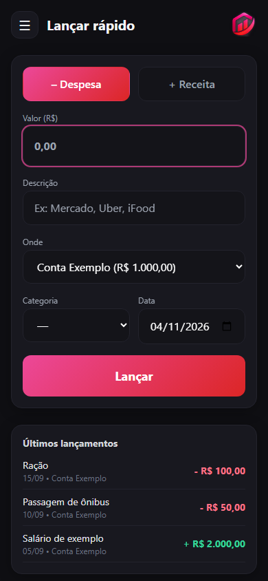

# AnaFins - Gestão Financeira Local

O AnaFins é um aplicativo de controle financeiro pessoal feito com foco em privacidade (local-first): sem nuvem, sem integração bancária e sem cadastro. Todos os dados ficam num banco SQLite no próprio computador. É feito em Python (Flask) e abre como aplicativo de desktop com a biblioteca pywebview. Também pode ser usado pelo celular, no Wi‑Fi de casa.

<p>
  
  
</p>

## Funcionalidades

* **Lançar rápido:** registra um gasto ou uma entrada em segundos, pensado para o celular.
* **Contas e saldos:** saldo de cada conta atualizado a cada lançamento.
* **Lançamentos:** receitas e despesas avulsas, com **mês de referência** (ex: o salário que cai no fim do mês conta no relatório do mês seguinte, que é quando ele é usado).
* **Cartões de crédito:** compras parceladas, datas de fechamento e vencimento, faturas por mês e pagamento de fatura.
* **Despesas:**
  * **Fixas:** contas recorrentes (aluguel, streaming, seguro...) com baixa por conta ou cartão e opção de desfazer.
  * **A pagar (pessoas):** o que você deve a alguém, em uma ou várias vezes (ex: "3x de R$ 200 para o meu irmão").
* **Chaves Pix:** suas chaves e as contas ligadas a cada uma (dados do Registrato), com botão de copiar.
* **Orçamento:** limite de gastos por categoria no mês.
* **Relatório mensal:** entradas, saídas, faturas e balanço do mês, com botão para **exportar tudo em PDF** (resumo, saldos, faturas item a item, compras, lançamentos, categorias, despesas fixas, a pagar e próximas faturas).
* **Visão geral:** saldo total, obrigações pendentes (faturas, despesas e parcelas do mês) e quanto está realmente disponível.

## Tecnologias

* Back-end: Python 3.11+ e Flask
* Front-end: HTML5, Jinja2 e Tailwind CSS
* Banco de dados: SQLite (`financas_local.db`)
* Desktop: pywebview

## Baixar e instalar

1. Baixe **[AnaFins-Setup.exe](https://github.com/ana-psg/finana-app/releases/latest/download/AnaFins-Setup.exe)** (só esse arquivo, sempre a versão mais nova) e abra. Não precisa de administrador nem de Python. As versões anteriores ficam em [Releases](https://github.com/ana-psg/finana-app/releases).
2. O Windows pode avisar "editor desconhecido" (o programa não tem assinatura digital paga): clique em **Mais informações > Executar assim mesmo**.
3. Abra pelo menu Iniciar: **AnaFins**.

Cada pessoa começa com o app vazio. Os dados ficam em `%APPDATA%\AnaFins`, e instalar uma versão nova por cima ou desinstalar **não apaga** nada.

> O WebView2 (motor da janela) já vem no Windows 10 e 11. Se a janela abrir em branco, instale o "Microsoft Edge WebView2 Runtime".

## Rodar pelo código (para desenvolver)

Precisa do Python 3.11 ou superior.

1. Clone o repositório:
   ```bash
   git clone https://github.com/ana-psg/finana-app.git
   cd finana-app
   ```
2. Instale as dependências:
   ```bash
   pip install -r requirements.txt
   ```
3. Abra o app com um duplo clique em `AnaFins.bat`, ou rode `python main.py`.
   Para abrir no navegador, rode `python -m finana.app` e acesse http://127.0.0.1:8000.

Rodando pelo código, o banco `financas_local.db` é criado sozinho na pasta do projeto (separado do app instalado) e **nunca vai para o Git**.

Para gerar o instalador: `pip install -r requirements-dev.txt`, instale o [Inno Setup 6](https://jrsoftware.org/isinfo.php) e rode `.\build.ps1`. Ele roda os testes, cria o executável, confere que nenhum dado pessoal entrou e salva `dist\AnaFins-Setup-<versão>.exe`.

## Usar no Celular (Wi‑Fi de casa)

1. No computador, abra o AnaFins e clique em **📱 Usar no celular** (rodapé do menu) para criar um PIN.
2. Com o celular no mesmo Wi‑Fi, leia o QR code ou digite o endereço mostrado (ex: `http://192.168.0.10:8000`).
3. Entre com o PIN e use **Adicionar à tela inicial** para abrir como um app.

O computador precisa estar ligado e com o AnaFins aberto. No próprio computador o PIN não é pedido.
Na primeira vez, permita o AnaFins (ou o Python, se rodar pelo código) em **Redes privadas** quando o Windows perguntar.

## Organização do Código

```
main.py             abre o app numa janela própria (o AnaFins.bat chama ele)
finana/             o app
  app.py              monta o app (banco + filtros + rotas)
  desktop.py          janela própria (pywebview) e servidor local
  db.py               conexão com o SQLite, criação do banco e migrações
  schema.sql          estrutura das tabelas (fonte da verdade do banco)
  utils.py            dinheiro (R$), meses e leitura de formulários
  net.py, qr.py       origem dos pedidos e QR code do celular
  services/           regras de negócio, sem nada de tela
    contas.py           saldos, lançamentos e mês de referência
    cartoes.py          compras parceladas, faturas e pagamento de fatura
    pagamentos.py       pagar por conta ou cartão (e desfazer), usado pelas despesas
    despesas_fixas.py   pagar / desfazer / excluir despesa fixa
    a_pagar.py          dívidas com pessoas e suas parcelas
    config.py           configurações (PIN do celular)
    relatorio.py        números do relatório mensal e da visão geral
    relatorio_pdf.py    monta o PDF do relatório completo (fpdf2)
  routes/             uma tela por arquivo (Flask Blueprints); acesso.py = PIN do celular
  templates/          HTML (Jinja2 + Tailwind); _macros.html = peças reaproveitadas
  static/             CSS gerado pelo Tailwind, logo e ícones
tools/              setup_db.py (cria/recria o banco), seed.py (dados de exemplo), verificar_pacote.py
packaging/          receita do executável (PyInstaller) e do instalador (Inno Setup); gerar com build.ps1
tests/              testes automáticos (pytest) e capturas de tela (e2e_telas.py)
backups/            cópias de segurança locais (fora do Git)
```

**Regra da casa:** a rota lê o formulário e mostra a tela; o cálculo e as mudanças no banco ficam em `services/`. Assim cada regra existe num lugar só e pode ser testada sem abrir o app.

Para criar uma tela nova: crie `finana/routes/<area>.py` com um Blueprint chamado `bp`, adicione o nome em `finana/routes/__init__.py` e no menu de `finana/templates/base.html`.

## Testes

```bash
pip install -r requirements-dev.txt
ruff check . && ruff format --check .
python -m pytest
```

Os testes usam um banco temporário e nunca tocam no `financas_local.db`.
Para ver as telas: `python tests/e2e_telas.py` (salva capturas em `data/telas`).

Depois de usar uma classe nova do Tailwind nos templates, gere o CSS de novo com `npm run css`.

## Privacidade

O `.gitignore` deixa fora do repositório o banco de dados, os backups e os arquivos `.zip`/`.rar`, porque eles contêm dados financeiros reais. Antes de enviar algo para o Git, confira com `git status` se nenhum desses arquivos aparece.
